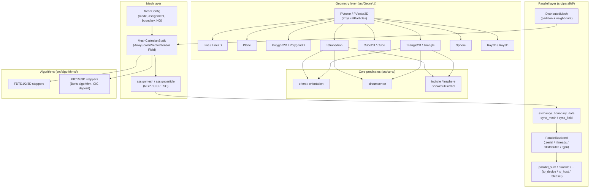

```@raw html
<!--
  Index page for PhysicalMeshes.jl.
  Rendered into the front page of the online documentation.
-->
```

# PhysicalMeshes.jl

*Tools to construct distributed, unitful Cartesian meshes for the JuliaAstroSim ecosystem.*

| Build | Docs |
|:-----:|:----:|
| [](https://github.com/JuliaAstroSim/PhysicalMeshes.jl/actions) | [](https://juliaastrosim.github.io/PhysicalMeshes.jl/dev) |

Source: [github.com/JuliaAstroSim/PhysicalMeshes.jl](https://github.com/JuliaAstroSim/PhysicalMeshes.jl)

---

## What is PhysicalMeshes.jl?

`PhysicalMeshes.jl` is a geometry + mesh construction toolkit that powers the
rest of the **JuliaAstroSim** stack (`PhysicalTrees`, `AstroNbodySim`,
`WaveDM`, `PhysicalSPH`, `PhysicalPlasma`, `AstroPlot`, …). It provides three
logically separate layers:

1. **A small, rigorous geometry library** for 2D/3D points (`PVector` from
   `PhysicalParticles.jl`) and the basic shapes built on top of them: `Line`,
   `Plane`, `Polygon`, `Triangle`, `Cube`, `Tetrahedron`, `Sphere`, `Ray`.
   Every primitive supports [`Unitful`](https://github.com/PainterQubits/Unitful.jl)
   quantities, so `Triangle(..., u"m")` and dimensionless
   `Triangle2D(PVector2D(...), ...)` interoperate transparently.

2. **A static Cartesian mesh (`MeshCartesianStatic`)** with `VertexMode` /
   `CellMode`, NGP / CIC / TSC mass-assignment schemes, Periodic / Dirichlet /
   Vacuum boundary conditions, single- and multi-component scalar / vector /
   tensor fields stored in array-backed wrappers (`ArrayScalarField`,
   `ArrayVectorField`, `ArrayTensorField`), and optional CPU / GPU device
   routing.

3. **A distribution layer** that gives the same mesh a parallel dimension:
   `ParallelBackend` abstracts `:serial` / `:threads` / `:distributed` / `:gpu`
   backends behind a uniform API; `DistributedMesh` partitions a global
   `MeshConfig` across worker processes and offers rendezvous halo exchange
   (`exchange_boundary_data`, `sync_mesh`, `sync_field`); `boris_algorithm` +
   `interpolate_field` + `deposit_charge` + `relax_poisson` provide a small
   FDTD / PIC solver stack on top of the mesh primitives.

The library is meant to be small, explicit, and easy to read; you should be
able to grep for the function name in `src/` and find the implementation in
the matching file.

## Highlights

- **Unitful-first** geometry: every primitive accepts and returns
  `Unitful.Quantity` coordinates. `len`, `area`, `volume`, `centroid`,
  `circumcenter`, `incircle`, `insphere` preserve units end-to-end.
- **Stable mesh-API**: the same mesh type works for CPU (`Array`) and
  GPU (`CuArray`) deployments. `assignmesh` / `assignparticle` /
  `mesh2particle` dispatch on `config.device` so user code does not have to
  branch on hardware.
- **Halo exchange built on `ParallelOperations.jl`**: a 3-phase
  send-to-stash / barrier / apply rendezvous that survives Julia 1.12's
  closure-serialisation edge cases.
- **Mass-assignment kernels** (`NGP`, `CIC`, `TSC`) for arbitrary `dim ∈
  {1, 2, 3}`, with `CellMode` / `VertexMode` selections and optional ghost
  zones (`NG`).
- **MHD-ready** field layout — `B`, `E`, `rho_e`, `j` are always present even
  on non-MHD meshes, so adding an EM solver does not perturb the struct
  type.
- **Numerical predicates** (`incircle`, `insphere`) follow Shewchuk's robust
  adaptive-arithmetic convention.

## Installation

```julia
julia> using Pkg

julia> Pkg.add("PhysicalMeshes")
```

Or install straight from GitHub:

```julia
julia> Pkg.add("https://github.com/JuliaAstroSim/PhysicalMeshes.jl")
```

`PhysicalMeshes.jl` is also a transitive dependency of every
JuliaAstroSim simulation package; in most cases you do not need to install it
explicitly.

## Quick start

A 30-second tour. See the [Guide](@ref) for a fuller walkthrough.

```@repl quickstart
using PhysicalMeshes
using PhysicalParticles
using AstroSimBase: CPU
using Unitful, UnitfulAstro

t = Triangle(PVector(0.0, 0.0, 0.0, u"m"),
             PVector(3.0, 4.0, 0.0, u"m"),
             PVector(3.0, 4.0, 12.0, u"m"))

len(t)               # 30 m
PhysicalMeshes.area(t) # 30 m^2
centroid(t)           # (2.0 m, 2.667 m, 4.0 m)
circumcenter(t)       # (1.5 m, 2.0 m, 6.0 m)

cfg = MeshConfig(uAstro; Nx = 8, Ny = 8, Nz = 8,
                 xMin = -1.0u"kpc", xMax = +1.0u"kpc")

m = MeshCartesianStatic(cfg; device = CPU())
m.rho
```

## Architecture at a glance



Five file-level groups:

| Path                          | Contents                                                                 |
|------------------------------|--------------------------------------------------------------------------|
| `src/`                       | Module entry, exports, top-level includes                                |
| `src/Line.jl` … `src/Sphere.jl` | Concrete geometry primitives                                            |
| `src/core/`                  | `orient`, `circumcenter`, `incircle_kernel`, `insphere_kernel`           |
| `src/mesh/`                  | `MeshConfig`, `MeshCartesianStatic`, `AbstractMesh`, `particle2mesh`, tools (`zoom`, `shrink`, `mass_center`, `total_mass`) |
| `src/field/`                 | `AbstractField`, `ArrayScalarField`, `ArrayVectorField`, `ArrayTensorField` |
| `src/parallel/`              | `ParallelBackend`, `operations`, `DistributedMesh`, halo exchange         |
| `src/algorithms/`            | `FDTD{1,2,3}D` and `PIC{1,2,3}D` reference steppers                     |

## Capability matrix

| Layer        | What you get                                                                             |
|--------------|------------------------------------------------------------------------------------------|
| Geometry     | `Line`, `Plane`, `Polygon{2D,3D}`, `Triangle{2D,3D}`, `Cube{2D,3D}`, `Tetrahedron`, `Sphere`, `Ray{2D,3D}` |
| Arithmetic   | `len`, `area`, `volume`, `centroid`, `midpoint`, `normal`, `orient`, `orientation`, `circumcenter` |
| Predicates   | `incircle`, `insphere`, `interior`, `exterior`, `is_inbound`, `isconvex`, `coplanar`     |
| Mesh config  | `VertexMode`, `CellMode`, `NGP`, `CIC`, `TSC`, `Periodic`, `Dirichlet`, `Vacuum`, `CPU()`, `GPU()` |
| Mesh types   | `MeshCartesianStatic`, `DistributedMesh`, `MeshUnstructured` (planned), `MeshHybrid` (planned) |
| Fields       | `ArrayScalarField`, `ArrayVectorField`, `ArrayTensorField`, broadcast / `sum` / `prod` / `dotview` overloads |
| Operations   | `assignmesh`, `assignparticle`, `particle2mesh!`, `mesh2particle`, `is_inbound`, `outbound_list`, `total_mass`, `mass_center` |
| Parallel     | `ParallelBackend`, `select_backend`, `detect_resources`, `to_device`, `to_host`, `distribute`, `release!`, `parallel_sum`, `parallel_maximum`, `parallel_minimum`, `parallel_findmax`, `parallel_quantile`, `parallel_sumprod`, `parallel_broadcast!`, `set_backend_fft_threads!` |
| Halo exchange | `DistributedMesh`, `exchange_boundary_data`, `sync_mesh`, `sync_field`                  |
| Algorithms   | `fdtd_step`, `fdtd_simulate`, `pic_step`, `pic_simulate`, `boris_algorithm`, `interpolate_field`, `deposit_charge`, `deposit_current`, `relax_poisson` |
| Mesh tools   | `zoom`, `shrink` (1D / 2D / 3D, optional interpolation)                                  |

## Where to next?

- **[Guide](@ref)** — installation, unit-aware workflow, mesh construction,
  assignment schemes, halo exchange.
- **[Manual](@ref)** — concrete pages for each geometry primitive, mesh type,
  field, operation, algorithm and parallel primitive.
- **[Library reference](@ref Methods)** — complete generated API index.
- **[GitHub](https://github.com/JuliaAstroSim/PhysicalMeshes.jl)** — source,
  issues, and PRs.

## Contributing

Issues and PRs are welcome via the GitHub repository. The package ships with
an end-to-end test suite under `test/`; you can run it from the package
directory with `Pkg.test("PhysicalMeshes")` or, for finer control, with
`julia --project test/runtests.jl`.
