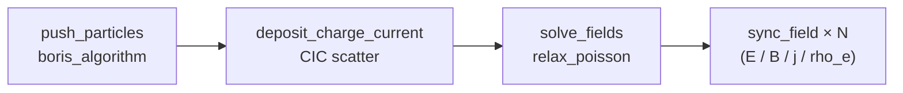

```@raw html
<!--
  Algorithms manual page (FDTD + PIC).
-->
```

# Algorithms (FDTD & PIC)

`PhysicalMeshes.jl` bundles two reference solvers that demonstrate how
to build higher-level physics on top of the mesh primitives. Both are
intentionally simple: production runs use the more specialised
implementations in `PhysicalPlasma.jl` / `NonlinearOptics.jl`. The
implementations here do, however, exercise every field, every boundary
condition, and the halo exchange code path end-to-end, so they double
as integration tests for the rest of the package.

## FDTD (Finite-Difference Time-Domain)

See [Library reference](@ref Methods) for `AbstractFDTD`, `FDTD2D`,
`FDTD3D`, `fdtd_step`, `fdtd_simulate`.

`fdtd = FDTD3D()` declares a 3D FDTD stepper. `fdtd_step(mesh, fdtd,
dt)` performs one Yee leapfrog step on the mesh's `E` and `B` fields:


For a `DistributedMesh`, the `sync_field` calls are inserted
automatically by `fdtd_step`; serial meshes skip them.

`fdtd_simulate(mesh, fdtd, dt, steps)` runs `fdtd_step` `steps` times
in a tight loop.

### Boundary conditions

See [Library reference](@ref Methods) for `apply_boundary_conditions`,
`apply_periodic_boundary`, `apply_dirichlet_boundary`, `apply_vacuum_boundary`.

The boundary selection is **per-step**, derived from
`mesh.config.boundary`. The convention is:

- `Periodic()` — copy the opposite edge into the ghost zone
- `Dirichlet()` — zero the ghost zone (absorbing zero-edge)
- `Vacuum()` — replicate the nearest interior cell (Sommerfeld / Mur
  first-order absorbing)

The four-branch dispatch (`nd ∈ {1, 2, 3, 4}`) covers 1D scalar, 1D
vector, 2D scalar / 2D vector and 3D fields; unallocated
(`field === nothing`) fields are silently skipped.

## PIC (Particle-in-Cell)

See [Library reference](@ref Methods) for `AbstractPIC`, `PIC2D`,
`PIC3D`, `pic_step`, `pic_simulate`.

A full PIC stepper combines four phases:



### Particle pushing

See [Library reference](@ref Methods) for `boris_algorithm`.

The Boris pusher is the standard second-order accurate, energy-
conserving velocity integrator for charged particles in EM fields. It
is robust to small `B`, and `boris_algorithm` short-circuits when
`iszero(B)` to avoid the cost of `dot` / `cross` on a near-zero vector.

### Field interpolation

See [Library reference](@ref Methods) for `interpolate_field`.

`interpolate_field(::ArrayVectorField, pos::PVector, cfg::MeshConfig)`
uses **CIC** weighting in 1D / 2D / 3D. The lower and upper tap
indices are clamped to `[1, Nmax]` to avoid `BoundsError` from
out-of-bound particles (see the inline comments in
`src/algorithms/PIC.jl`).

### Charge / current deposit

See [Library reference](@ref Methods) for `deposit_charge`,
`deposit_current`.

CIC deposition for charge (`rho_e`) and current (`j`). Both methods
filter out-of-bound particles via `is_inbound(pos, cfg)` and clamp the
upper tap to `Nx` / `Ny` / `Nz` to keep the deposit conservative.

### Poisson relaxation

See [Library reference](@ref Methods) for `relax_poisson`.

A simple Jacobi iteration that runs 100 steps of the 1D / 2D / 3D
discrete Poisson equation with the `rho_e` source on the right-hand side.
Production solvers should use multigrid or spectral FFT (which is
implemented in `PhysicalFFT.jl` on top of `PhysicalMeshes.jl`), but for
small test cases the Jacobi solver is more than adequate.

## Example: a tiny FDTD run

```julia
using PhysicalMeshes
using PhysicalParticles, Unitful, UnitfulAstro

cfg  = MeshConfig(uAstro; Nx = 16, Ny = 16, Nz = 16,
                  xMin = -1.0u"kpc", xMax = +1.0u"kpc",
                  boundary = Periodic())
mesh = MeshCartesianStatic(cfg; mhd = true)

fdtd = FDTD3D()
fdtd_simulate(mesh, fdtd, 1e-4, 100)
```

For a PIC run, swap `mhd = false` for `mhd = true` (so `B`, `E`,
`rho_e`, `j` are allocated), populate `mesh.data` with particles
carrying `Pos`, `Vel`, `Charge`, `Mass`, and call `pic_simulate`
instead.

## Limitations and caveats

- **No adaptive timestep** — `dt` is fixed; you must choose it
  small enough to satisfy the FDTD / CFL condition (e.g.
  `dt ≤ Δ / (c √dim)`).
- **No current smoothing / Esirkepov deposit** — `deposit_current` is a
  first-order CIC deposit. For more advanced options use
  `PhysicalPlasma.jl`.
- **No field solvers other than Jacobi** — `relax_poisson` runs 100
  hard-coded iterations and stores the result in `E`. Use
  `PhysicalFFT.jl` for spectral solvers.
- **Periodic BC default** — the FDTD reference uses `Periodic` boundary
  by default. To model open boundaries you need an explicit
  `Dirichlet` / `Vacuum` configuration.
