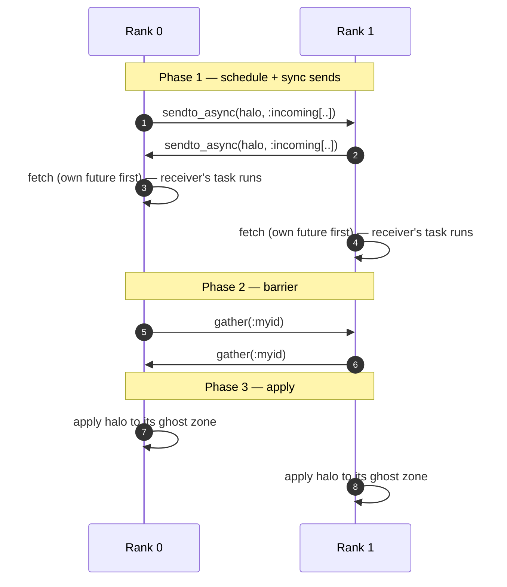

```@raw html
<!--
  DistributedMesh manual page.
-->
```

# Distributed Mesh

`DistributedMesh` is the multi-process mesh wrapper: it partitions a
global [`MeshConfig`](@ref) across `Distributed` worker processes,
holds a local `MeshCartesianStatic` on each rank, and offers rendezvous
halo exchange.

## Type

## Constructors and layout

`DistributedMesh(config, units = nothing; kw...)` is the user-facing
constructor (see [Library reference](@ref Methods)). It:

1. Reads `myid() - 1` as the rank (0-based, with the master process at
   rank 0) and `nworkers() + 1` as the partition size.
2. Calls `calculate_local_config(config, rank, size)` to compute the local
   `MeshConfig` for this rank.
3. Constructs a `MeshCartesianStatic(local_config, nothing, units;
   kw...)` with the supplied kernel arguments (`mode`, `assignment`,
   `boundary`, …).
4. Calls `partition_neighbors(rank, size, config.dim)` to enumerate the
   neighbour ranks.
5. Returns the struct.

See [Library reference](@ref Methods) for `calculate_local_config` and
`partition_neighbors`.

The decomposition strategy:

- **`dim = 1`** — 1D decomposition of `Nx` along the `x`-axis. Every
  rank owns `Nx ÷ size` cells (or `Nx ÷ size + 1` for the first
  `Nx % size` ranks). The `+1` remainder is consistent with
  `MPI_BLOCK` semantics.
- **`dim = 2`** — 2D `rows × cols` grid layout with
  `rows = ceil(√size)` and `cols = ceil(size / rows)`. The local
  sub-extent is derived from the rank's `(row, col)` position.
- **`dim = 3`** — 1D slab decomposition along the `x`-axis (rows are
  split across ranks; `y` and `z` are kept whole). The current 3D
  layout is a thin wrapper around the 1D case — full `rows × cols ×
  slabs` support is left for future work.

## Field access

`DistributedMesh` delegates every standard mesh field (`pos`, `vel`,
`acc`, `e`, `rho`, `phi`, `B`, `E`, `rho_e`, `j`) to its
`local_mesh` through a `Base.getproperty` shim:

```julia
m.rho          # === local_mesh.rho
m.config       # === the global config (stored on the struct itself)
m.local_mesh   # === the local MeshCartesianStatic
m.rank, m.size, m.neighbors
```

`Base.setproperty!` is handled by the `AbstractMesh` default that
dispatches on whether the symbol is a real field on the struct; the
non-delegated fields (`config`, `local_mesh`, `rank`, `size`,
`neighbors`) cannot be reassigned.

`number_of_nodes`, `number_of_cells`, and `number_of_fields` are also
forwarded to `local_mesh`, so the rest of the JuliaAstroSim ecosystem
can treat a `DistributedMesh` like any other `MeshCartesianStatic`.

## Halo exchange

See [Library reference](@ref Methods) for `exchange_boundary_data`,
`sync_mesh`, `sync_field`.

`exchange_boundary_data(mesh, :rho; pid_for_rank = r -> r + 1)` is the
core rendezvous primitive. It exchanges the ghost zone of any field
(`rho`, `phi`, `e`, `B`, `E`, …) between every pair of neighbour ranks
in three phases:



1. **Phase 1 — schedule + sync sends.** For every neighbour, fire a
   `sendto_async` deposit into the receiver's `HaloStash.incoming` dict,
   keyed by `(sender_rank, field_name)`. `fetch`ing the resulting
   `Future` is the trick that makes the rendezvous race-free: while the
   master (or worker) is blocked on its own future, its local task
   queue runs the worker's sendto task, populating the local
   `HaloStash`. By the time master returns from `fetch`, the entry is
   visible locally.
2. **Phase 2 — barrier.** `gather(all_pids, :myid, ParallelOperations)`
   is the rendezvous: both sides have finished Phase 1, so both sides
   have populated each other's stashes.
3. **Phase 3 — apply.** Each rank reads its own `HaloStash.incoming`,
   copies the slice into its local ghost zone via `selectdim`, and
   deletes the entry (clean-up is important — otherwise the dict
   grows unboundedly across steps).

If a rank has no neighbours (single-rank or serial run), `exchange_boundary_data`
short-circuits to `nothing`.

### Convenience wrappers

`sync_mesh(mesh)` calls `exchange_boundary_data` on `:rho`, `:phi`, and
`:e` (the standard fields used by every JuliaAstroSim simulation). For
MHD / PIC workflows, you should also call `sync_field(mesh, :B)` /
`sync_field(mesh, :E)` / `sync_field(mesh, :j)` etc. by hand — they are
not in the default set.

### Direction conventions

`extract_halo(mesh, dir, field_name)` returns the slice at the side of
`dir`; `apply_halo!` writes the received slice into the **opposite**
side of the ghost zone. The direction encoding is:

- `±1` — `x`-axis (1D partition or 2D partition column neighbours)
- `±2` — `y`-axis (2D partition row neighbours)
- `+` = max-end, `-` = min-end

`sync_mesh` uses this internally to pick the right slice for every
neighbour pair.

### Custom pid mapping

The default convention assumes rank `r` lives on Distributed pid `r + 1`.
If your `ClusterManager` assigns non-contiguous pids (e.g. `0`-padded
slurm job IDs), pass a custom `pid_for_rank`:

```julia
exchange_boundary_data(mesh, :rho; pid_for_rank = cluster_pid_for_rank)
```

## Example: distributed halo exchange

```julia
using Distributed
addprocs(4)

@everywhere using PhysicalMeshes
@everywhere using Unitful, UnitfulAstro

@everywhere function setup_and_sync()
    cfg = MeshConfig(uAstro; Nx = 16, Ny = 4, Nz = 4,
                     xMin = -1.0u"kpc", xMax = +1.0u"kpc")
    m = DistributedMesh(cfg, uAstro)

    # ...compute / update m.rho on every rank...

    sync_mesh(m)
end

setup_and_sync()
```

For a serial run, `DistributedMesh` is still usable — every rank is
its own neighbour list (empty), so `sync_mesh(m)` is a no-op. This makes
it convenient to keep the same code path for both serial tests and
large distributed runs.

## Halo-stash clean-up

`HaloStash.incoming` is a module-level Dict shared across calls and
ranks. After every apply we `delete!` the entry, so steady-state size
is bounded by `O(neighbours * fields)`. If you run an iteration that
errors out before Phase 3, the keys for the failing iteration can leak;
restart the Julia process or call `empty!(HaloStash.incoming)` to
recover.
