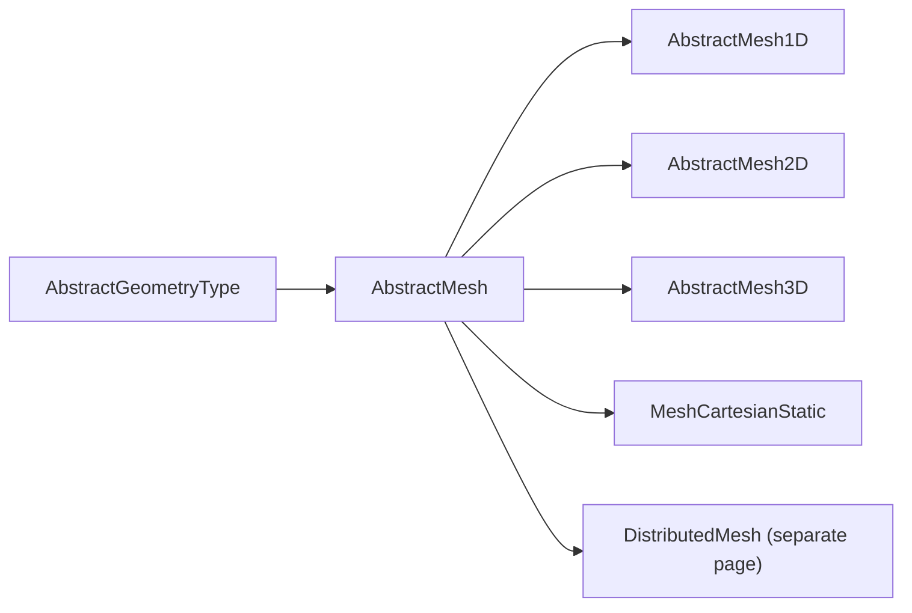

```@raw html
<!--
  MeshCartesianStatic manual page.
-->
```

# Static Cartesian Mesh

`MeshCartesianStatic` is the central mesh type: a static, axis-aligned,
unit-aware Cartesian grid carrying scalar / vector / tensor fields, with
configurable mass-assignment schemes (`NGP` / `CIC` / `TSC`), boundary
conditions (`Periodic` / `Dirichlet` / `Vacuum`), and CPU / GPU device
routing. It is the building block for [`DistributedMesh`](@ref
manual/Distributed-Mesh), for the FDTD / PIC reference algorithms, and for
the entire mass-assignment pipeline used by the JuliaAstroSim ecosystem.

## Type hierarchy




The mesh hierarchy lives in [`src/mesh/AbstractMesh.jl`](@ref). Every
mesh subtype implements the field / config trait and falls back to
abstract `cell_volume`, `cell_area`, `cell_center`, `interpolate_field`,
`add_node!`, `add_cell!`, `add_field!`, `get_field`, `node_neighbors`,
`cell_neighbors`, `number_of_nodes`, `number_of_cells`,
`number_of_fields` methods that throw a domain error when a concrete
implementation does not override them.

## `MeshConfig` — the descriptive half

A `MeshConfig` is an immutable struct with the following fields, in order:

| Field          | Type                  | Meaning                                                          |
|----------------|-----------------------|------------------------------------------------------------------|
| `mode`         | `MeshMode`            | `VertexMode()` (default) or `CellMode()`                         |
| `assignment`   | `MeshAssignment`      | `NGP()`, `CIC()` (default), or `TSC()`                           |
| `boundary`     | `BoundaryCondition`   | `Periodic()` (default), `Dirichlet()`, `Vacuum()`                |
| `enlarge`      | `Float64`             | Used by `extent(particles) * enlarge` callsite                   |
| `device`       | `DeviceType`          | `CPU()` (default) or `GPU()`                                     |
| `units`        | `U`                   | `nothing`, `uAstro`, `uSI`, `uCGS`, or `uGadget2`                |
| `dim`          | `Int`                 | Number of active spatial dimensions (1, 2, or 3)                 |
| `NG`           | `Int`                 | Number of ghost cells in each direction                          |
| `Δ`            | `Vector`              | Cell resolution in each direction                                 |
| `Min`          | `Vector`              | Lower coordinate of the active cell range in each direction      |
| `Max`          | `Vector`              | Upper coordinate of the active cell range in each direction      |
| `N`            | `Vector{Int}`         | Number of *cells* in each direction                              |
| `Len`          | `Vector{Int}`         | Total number of cells (incl. ghost zones) per direction          |

All constructors default `Nx = Ny = Nz = 5`, `xMin = -1`, `xMax = +1`,
`yMin = xMin`, `yMax = xMax`, `zMin = xMin`, `zMax = xMax`,
`mode = VertexMode()`, `assignment = CIC()`, `boundary = Periodic()`,
`device = CPU()`, `dim = 3`, `NG = 0`. `Δ`, `Min`, `Max`, `N`, and
`Len` are derived from these; the constructor truncates each vector to
`config.dim` entries.

## Sampling mode and assignment kernel

The mode / assignment traits (`CellMode`, `VertexMode`, `NGP`, `CIC`, `TSC`)
carry no docstrings themselves; see [Library reference](@ref Methods).

- `CellMode` — fields are defined at **cell centres**. Each direction
  holds exactly `N` values.
- `VertexMode` — fields are defined at grid **vertices**. Each direction
  holds `N + 1` values (default).
- `NGP` / `CIC` / `TSC` are the three mass-assignment kernels. They
  control both the scatter (`assignmesh` / `particle2mesh!`) and the
  gather (`mesh2particle` / `assignparticle`) directions; the kernels are
  selected automatically based on `config.assignment` and `config.mode`.

## Fields

The three field wrapper types `ArrayScalarField`, `ArrayVectorField`, and
`ArrayTensorField` are defined in [`src/field/FieldTypes.jl`](@ref). Their
docstrings live in the [Library reference](@ref Methods).

`MeshCartesianStatic` owns:

| Field    | Storage                              |
|----------|--------------------------------------|
| `pos`    | `StructArray` of `PVector`           |
| `vel`    | `ArrayVectorField`                   |
| `acc`    | `ArrayVectorField`                   |
| `e`      | `ArrayScalarField` of energy density |
| `rho`    | `ArrayScalarField` of mass density   |
| `phi`    | `ArrayScalarField` of potential      |
| `B` / `E`| `ArrayVectorField` of MHD fields     |
| `rho_e`  | `ArrayScalarField` of charge density |
| `j`      | `ArrayVectorField` of current density|

Common reductions (`sum`, `prod`, `minimum`, `maximum`, `extrema`) and
broadcasted arithmetic / `m.rho[2:end-1, ...] .= rhs` slice-assignment
are forwarded to the underlying `Array` so the wrappers are transparent
(see [`src/field/FieldTypes.jl`](@ref)).

The grid positions are stored in either a `StructArray{PVector}` (for
`dim ≥ 2`) or a `Vector{PVector}` (the 1D special case, which avoids the
StructArray bookkeeping overhead).

## Constructors

`MeshCartesianStatic` has four constructor paths:

In short:

1. `MeshCartesianStatic(cfg::MeshConfig)` — descriptor + nothing else
2. `MeshCartesianStatic(cfg, particles, units; mhd, data_on_cpu, ...)` —
   descriptor plus an explicit particle struct array
3. `MeshCartesianStatic(units = nothing; mhd, data_on_cpu, kw...)` —
   derived from a `MeshConfig` built on the spot with the given keywords
4. `MeshCartesianStatic(particles, units; mode, assignment, boundary,
   Nx, Ny, Nz, NG, xMin, xMax, ..., enlarge, cube, assign, kw...)` —
   derived from the particles' extent times `enlarge` (default `2.01`)
   and the supplied keyword arguments; also performs
   `assignmesh(particles, m, :Mass, :rho)` by default unless `assign = false`

For convenience, `MeshCartesianStatic(::Array)` accepts the same keyword
arguments and dispatches to the `StructArray` constructor.

The constructor's `assign = true` default makes it trivial to construct
a mesh, populate it with particle masses, and immediately inspect the
resulting density field.

## Mass-assignment API

`assignmesh` and `assignparticle` are exported (see [Library reference](@ref Methods)).

`assignmesh(particles, mesh, :Mass, :rho)` is the entry point on
`MeshCartesianStatic`: it zeros `mesh.rho`, walks over all particles,
dispatches to the kernel selected by `config.assignment` / `config.mode`
(NGP / CIC / TSC), and writes the cell density into `mesh.rho.data`.

`mesh2particle(particles, mesh, :Acc, :acc)` walks the same particles
in reverse and updates the `:Acc` field by interpolating `mesh.acc`.

The intermediate kernels `particle2mesh!` and `mesh2particle` are
also exported and accept an explicit `mode::MeshMode` / `assignment::MeshAssignment`
pair, but you should prefer the high-level `assignmesh` / `assignparticle`
wrappers.

## In-bound / out-bound checks

See [Library reference](@ref Methods) for `is_inbound` and `outbound_list`.

`is_inbound(pos, mesh.config)` returns whether `pos` lies inside the mesh
domain; the implementation iterates over `config.Min / config.Max`
independently of `config.dim`, so a `1D` or `2D` mesh does not raise a
`BoundsError`. `outbound_list(...)` returns the indices of all particles
that lie outside the domain — useful for the PIC / SPH workflows that
have to clamp particle trajectories back into the box at every step.

## Mesh tools

`total_mass`, `mass_center`, `zoom`, `shrink` are exported (see
[Library reference](@ref Methods)).

`total_mass(m)` integrates `m.rho` over the cell volume
`prod(config.Δ)`. `mass_center(m)` returns the density-weighted mean
position, falling back to the mean vertex position when `rho` is empty.

`zoom(a, ratio)` / `shrink(a, ratio)` resize 1D / 2D / 3D arrays by an
integer ratio. `zoom` accepts an `Interpolations` interpolator (e.g.
`LinearInterpolation`) for smooth upsampling; otherwise it does
nearest-neighbour replication.

## Example

```@repl mesh
using PhysicalMeshes
using PhysicalParticles
using AstroSimBase: Periodic, CPU
using Unitful, UnitfulAstro

# Build a VertexMode CIC Periodic 3D mesh spanning ±1 kpc
cfg = MeshConfig(uAstro;
                 Nx = 4, Ny = 4, Nz = 4,
                 xMin = -1.0u"kpc", xMax = +1.0u"kpc")

m = MeshCartesianStatic(cfg)
m.rho              # ArrayScalarField, size (5, 5, 5) — VertexMode
m.config.assignment        # CIC()
m.config.boundary          # Periodic()

# Particle constructor (auto-assigns :Mass → :rho)
pos = [
    PVector(-1.0, -1.0, -1.0),
    PVector(-1.0, +1.0, -1.0),
    PVector(+1.0, -1.0, -1.0),
    PVector(+1.0, +1.0, -1.0),
    PVector(-1.0, -1.0, +1.0),
    PVector(-1.0, +1.0, +1.0),
    PVector(+1.0, -1.0, +1.0),
    PVector(+1.0, +1.0, +1.0),
]

dataArray = [Ball() for _ in 1:8]
assign_particles(dataArray, :Pos,  pos)
assign_particles(dataArray, :Mass, 1.0)

m2 = MeshCartesianStatic(dataArray)
sum(m2.rho) * m2.config.Δ[1]^3 ≈ 8.0
```

The example above uses `assign_particles` / `Ball` from `PhysicalParticles`.

## Device routing

`MeshCartesianStatic` carries a `MeshConfig.device` field (`CPU()` or
`GPU()`). The constructor copies particles and positions to a `CuArray`
when `device = GPU()` is requested, with the `data_on_cpu = true`
keyword available for the (rare) cases where you want the field data on
host but the particle handle on the device. `m.config.device` is what
the mass-assignment and halo-exchange code dispatch on.

To summarise the device handling:

- `CPU()` is the default and is a no-op — `pos` and `data` remain on
  the host as plain `Array` / `StructArray`.
- `GPU()` calls `cu(...)` on the particle array and the position arrays.
  Field storage (`m.rho.data` etc.) stays as a regular `Array` because
  the mass-assignment kernels move the data through `_field_data` /
  `Base.Array` round-trips; if you want the field on the device, you must
  explicitly call `cu(m.rho.data)`.
- `mhd = true` causes `B`, `E`, `rho_e`, and `j` to be allocated as
  non-zero `ArrayVectorField` / `ArrayScalarField` rather than the
  zero-placeholder fields used for non-MHD meshes.

See [`Distributed Mesh`](@ref manual/Distributed-Mesh) for the
distributed variant.
